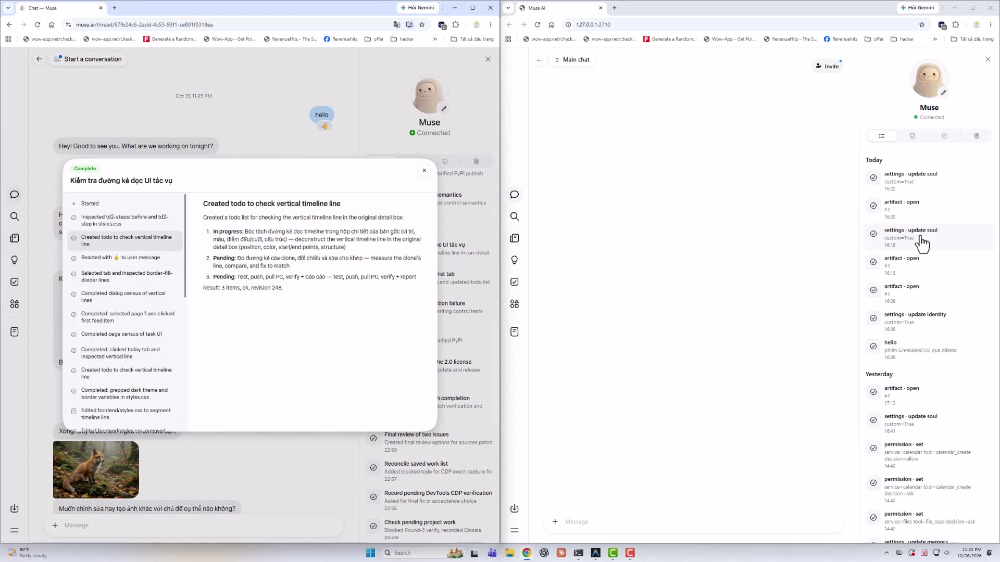
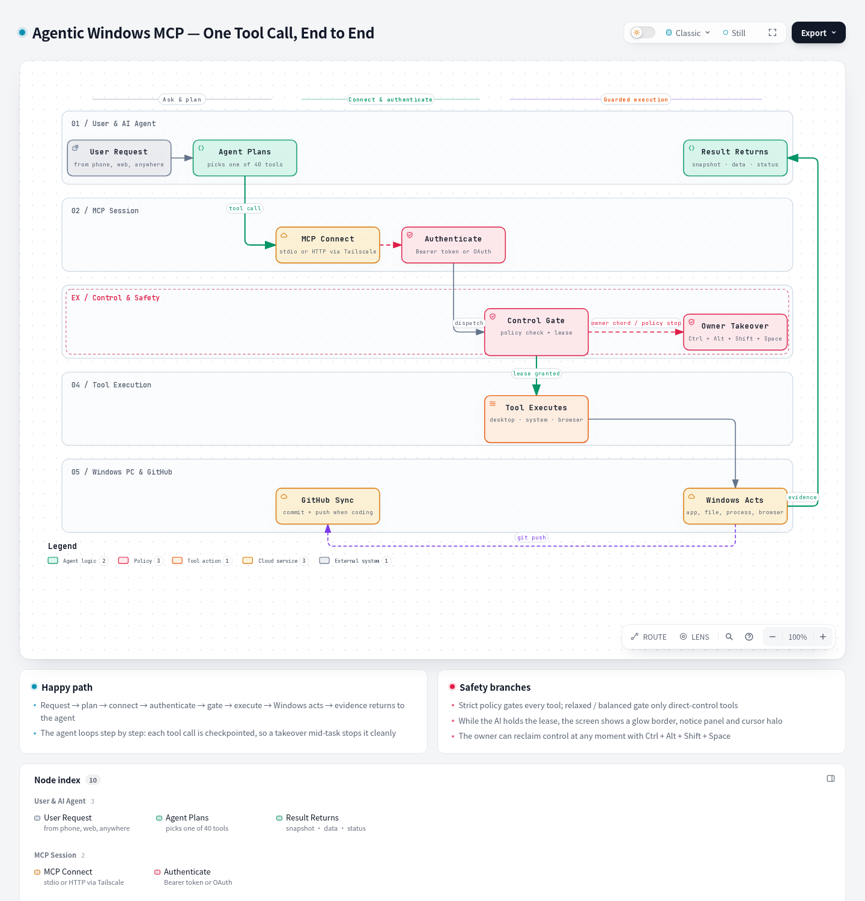
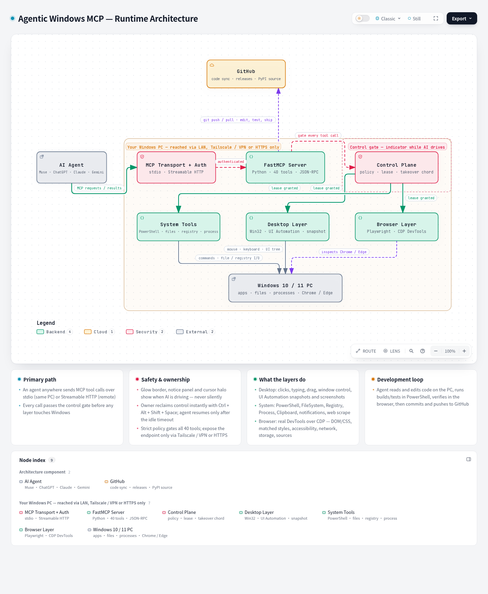

<div align="center">


# Agentic Windows MCP

### Your AI agent's hands on your Windows PC — from anywhere on Earth

**Full remote desktop control · Deep browser DevTools · Real coding on your own machine, driven by any AI agent**

[](LICENSE.md)
[](https://pypi.org/project/agentic-windows-mcp/)


[](https://trendshift.io)

**English** · [Tiếng Việt](README.vi.md) · [한국어](README.ko.md) · [中文](README.zh.md)

</div>

---

## 🎬 See it in action

The left half is **muse.ai** (Meta's hosted agent). The right half is a **self-hosted clone of it, built from scratch** — and the hands driving both screens belong to AI agents connected through Agentic Windows MCP. Every click, keystroke, file edit and browser inspection in this video was performed by an agent, on a real PC, through this server.

<div align="center">

<video src="https://github.com/homenewstar/agentic-windows-mcp/raw/refs/heads/main/assets/demo-clone.mp4" controls width="100%"></video>

<a href="assets/demo-clone.mp4"></a>

▶ **[Watch the demo — 34 seconds](assets/demo-clone.mp4)**: original vs. clone, side by side, both operated live by AI agents.

</div>

---

## 🤖 A product built 100% automatically — no human hands

This project is itself the proof of concept. It was produced **entirely by an automated trio**, replacing the human developer end-to-end:

| The trio | Role in the pipeline |
|---|---|
| **ChatGPT Web** | The brain: planning, coding, reviewing, deciding — through a browser, like a human would |
| **GitHub** | The backbone: source of truth, version history, releases, CI |
| **A personal computer** | The workplace: where code actually ran, apps actually opened, tests actually executed |

ChatGPT Web connected to GitHub and to the personal computer, and the loop — *write code → run it on the real machine → look at the real screen → fix → commit* — ran **fully automatically, in place of a human**.

The flagship result of that loop is the demo above: a from-scratch clone of muse.ai, built and verified screen-by-screen against the original:

- 🎯 **Frontend fidelity: 99%** — layout, spacing, typography and interactions matched pixel-by-pixel against the reference
- ⚙️ **Backend coverage: > 60%** — agent loop, tools, memory, scheduling, approvals and security model re-implemented
- ⏱️ **Total time: just over 1 day** — from an empty repository to a working, self-hosted product

Agentic Windows MCP is the component that made the "personal computer" leg of that trio real. **Install it, and any agent you use gets the same power over your machine.**

---

## 💡 The core idea — three pillars

Alone, an AI agent can only *talk*. Alone, your PC just *sits there*. **Agentic Windows MCP** is the bridge that turns the two of them — plus GitHub — into a complete working machine:

| Pillar | Role | Lives where? |
|---|---|---|
| **1. GitHub** | The source hub: sync, version history, the meeting point of every change | GitHub's cloud |
| **2. The AI Agent** | The "brain": Muse, ChatGPT, Claude, Gemini, DeepSeek… analyzes, decides, writes code, issues commands | Web, phone app, another machine — anywhere |
| **3. Your computer / server** | The "hands + the real workplace": projects live here, code runs here, real apps open here — Agentic Windows MCP is installed here to execute | Home PC, office machine, Windows VPS… |

The three pillars are **completely independent geographically**, joined by only two pipes: the **MCP protocol** (Agent ⇄ your machine) and **Git** (your machine ⇄ GitHub). So:

- You're at a café, you open ChatGPT on your phone → give an order → the agent drives the PC at home: opens the project, edits code, runs tests, commits and pushes to GitHub. You arrive home: everything is done.
- Or collapse all three into **a single machine**: the agent app runs on the same PC, the code lives on the same PC — Agentic Windows MCP lets the agent operate it like a programmer sitting in front of it.

---

## ✨ Key features

### 🖥️ Total desktop control
- **Mouse & keyboard like a human**: click, double/right-click, multi-point drag paths, press-and-hold, swipe, Unicode text typing, hotkey chords, scrolling — down to pixel precision.
- **Reads the screen via the UI Automation tree**: a "Snapshot" of every element of the active window (buttons, inputs, labels…) with numbered screenshot annotations — the agent understands UIs **without a vision model**.
- **Window & app management**: launch apps, switch/close/resize windows, multi-monitor, virtual desktops, region screenshots.
- **Clipboard, notifications, displays**: read/write clipboard, send system notifications, manage screens.

### ⚙️ System automation
- **Unrestricted PowerShell**: run commands, install software, administer the system.
- **FileSystem**: read/write/list/move files & folders — read and edit source code directly.
- **Registry & Process**: inspect/edit the registry, list & terminate processes.
- **Scrape**: download and extract web page content.

### 🌐 Browser inspection like real DevTools (F12)
The Browser toolset connects to your already-open Chrome/Edge/Brave via **CDP (Chrome DevTools Protocol)**:
- Navigate, manage tabs, DOM snapshots, element queries, visual highlighting, arbitrary JavaScript execution.
- Deep CSS: computed styles, **matched rules** (which rule wins, from which stylesheet), `::before`/`::after`, animations — plus the **Accessibility tree**.
- **Deep Network**: response bodies, request payloads, per-phase timing (DNS/TCP/TLS/TTFB), transfer sizes, redirect chains, failed requests, WebSocket frames, TLS certificate details.
- **Application storage**: cookies (including **HttpOnly**), local/session storage, IndexedDB, Cache Storage, Service Workers.
- **Sources**: list & read the full source of every script/stylesheet.

### 👨‍💻 Remote coding on your own machine
Combine the toolsets and an agent can run the full life-cycle of a coding task right on your PC: open the IDE/project folder → read code → edit files → build & test via PowerShell → open the browser and verify with DevTools → fix → `git commit` & `git push` to GitHub. You just give orders and supervise — from your phone if you like.

### 🛡️ Safety & control stay yours
- **Always-on visual indicator**: while the AI is in control, your screen shows a **glowing border** + a notice panel at the top edge + an aura around the cursor — it never controls your PC "in secret".
- **Take-back key**: press **`Ctrl + Alt + Shift + Space`** to seize control back instantly; the agent only resumes after you've been idle long enough.
- **Three control policies** (`relaxed` / `balanced` / `strict`): at strict, *every* action passes through the control gate with the indicator shown.
- **Agent-priority mode** (optional): the agent is not interrupted by ordinary mouse/keyboard input — only the chord above can take over.
- **Mandatory authentication**: API key via `Authorization: Bearer <token>` header or OAuth; expose the endpoint only over a private network (Tailscale/WireGuard) or HTTPS.
- **No telemetry by default**: the source ships with no tracking key; usage analytics activates only if you set the `POSTHOG_API_KEY` environment variable yourself.

---

## 🏗️ Workflow & architecture

<div align="center">



*One tool call, end to end — request → plan → connect → authenticate → control gate → execution → result. [Interactive version](assets/workflow.html).*



*Runtime architecture — transport + auth, the FastMCP server, the control plane, and the desktop / system / browser layers over Windows. [Interactive version](assets/architecture.html).*

</div>

```
                    ┌─────────────────────────────┐
                    │           GITHUB            │
                    │   source · sync · releases  │
                    └──────────────┬──────────────┘
                          git push/pull
                    ┌──────────────▼──────────────┐
   ┌─────────────┐  │   YOUR COMPUTER             │      ┌──────────────────┐
   │  AI AGENT   │  │   ┌───────────────────────┐  │      │      USER        │
   │ Muse ·     ├──┼──►│  AGENTIC WINDOWS MCP  │◄─┼──────┤ supervises ·     │
   │ ChatGPT ·   │MCP│   │  40 control tools     │  │ sees │ glowing border   │
   │ Claude ·    │◄──┼──┤  mouse · keys · apps  │  │      │ · notice panel   │
   │ Gemini ·    │  │   │  PowerShell · files   │  │      │ · Space chord*   │
   │ DeepSeek... │  │   │  Browser DevTools     │  │      └──────────────────┘
   └─────────────┘  │   └───────────────────────┘  │
   (web / app /     │   Windows 10 / 11            │
    another PC)     └─────────────────────────────┘
                     *take-back chord: Ctrl + Alt + Shift + Space
```

```
Agent (MCP client)
   │  JSON-RPC: stdio / Streamable HTTP (+ Bearer token / OAuth)
   ▼
Agentic Windows MCP (FastMCP, Python)
   ├── Desktop layer .... Win32 API + UI Automation (element tree, screenshots)
   ├── Control plane .... the gate: glowing border, notice panel, policies
   │                      relaxed/balanced/strict, take-back chord, lease queue
   ├── System layer ..... PowerShell, FileSystem, Registry, Process
   └── Browser layer .... Playwright + raw CDP (Network/CSS/DOM/
                          Accessibility/Debugger/Storage domains)
   ▼
Windows 10 / 11
```

The main source lives in `src/agentic_windows_mcp/` (`desktop/`, `browser/`, `tools/`, `infrastructure/`, `filesystem/`, `powershell/`, `registry/`, `uia/`…).

---

## 🚀 Installation (on the Windows machine to be controlled)

**Requirements**: Windows 10/11 · Python 3.12+ · [uv](https://docs.astral.sh/uv/) · Git.

### Option 1 — from PyPI (quickest)

```powershell
pip install agentic-windows-mcp
# or, isolated, with uv:
uv tool install agentic-windows-mcp
```

### Option 2 — from source

```powershell
git clone https://github.com/homenewstar/agentic-windows-mcp.git
cd agentic-windows-mcp
uv sync
```

> The Browser/DevTools tools talk to your existing Chrome/Edge over CDP. If you also want the server to launch its own Chromium, run `playwright install chromium` once.

### Run the server

**HTTP mode (for remote agents / over the network)** — with an auth key:

```powershell
# Create / rotate the auth key (stored in ~/.agentic-windows-mcp/)
agentic-windows-mcp auth

# Start the MCP server over HTTP
agentic-windows-mcp serve --transport streamable-http --host 0.0.0.0 --port 8000
# Endpoint: http://<your-PC-IP>:8000/mcp
```

(When installed from source, prefix the commands with `uv run`.)

**stdio mode (agent on the same machine**, e.g. Claude Desktop, Cursor, VS Code): see the connection configs below — the client launches the server itself via `uvx`.

### Start with Windows

```powershell
agentic-windows-mcp install     # create the "agentic-windows-mcp-server" Scheduled Task
agentic-windows-mcp uninstall   # remove the task and stop the server
```

### Expose the endpoint safely

Never open the port directly to the Internet. Use one of:

- **Tailscale** (recommended): install Tailscale on both the PC and your device, then `tailscale serve --bg --https=443 http://127.0.0.1:8000` — the endpoint appears only inside your private tailnet.
- **WireGuard / a self-hosted VPN**, or an HTTPS reverse proxy (Caddy/Nginx) with authentication.

### Configuration

The config file lives at `~/.agentic-windows-mcp/config.toml`:

```toml
[server]
# default host / port / transport...

[control]
enabled = true
policy = "strict"        # relaxed | balanced | strict
idle_timeout_seconds = 10
```

---

## 🔌 Connect your AI agent

The general rule: **any application that speaks MCP (Model Context Protocol) can connect**, over stdio (same machine) or Streamable HTTP (over the network, with an `Authorization: Bearer <API_KEY>` header).

### Muse (muse.ai) & web/app agents
Web-based agents don't install software on your machine — they connect to Agentic Windows MCP's HTTP endpoint:

1. Run the server in HTTP mode as above and expose it via Tailscale/HTTPS.
2. In the agent, add a **custom connector / MCP server** with the URL `https://<your-machine>/mcp` and your auth key.
3. The agent sees all 40 tools and can drive your PC — including opening projects, editing code and pushing to GitHub.

### ChatGPT
ChatGPT supports MCP through **Developer mode / Connectors**:

1. Settings → Connectors → enable Developer mode → *Create* a new connector.
2. Enter the MCP URL (`https://<your-machine>/mcp`) and the API key.
3. In a conversation, enable the connector and give an order, e.g.: *"Open project X on my PC, run the tests and fix whatever fails."*

### Claude (Claude Desktop & Claude Code)
Same machine — stdio, Claude launches the server itself:

```json
{
  "mcpServers": {
    "agentic-windows-mcp": {
      "command": "uvx",
      "args": ["agentic-windows-mcp"]
    }
  }
}
```

Different machine — point it at the HTTP endpoint:

```json
{
  "mcpServers": {
    "agentic-windows-mcp": {
      "url": "http://<your-PC-IP>:8000/mcp",
      "headers": { "Authorization": "Bearer <API_KEY>" }
    }
  }
}
```

Claude Code: `claude mcp add --transport http agentic-windows-mcp http://<your-PC-IP>:8000/mcp --header "Authorization: Bearer <API_KEY>"`.

### Gemini
- **Gemini CLI**: add the same `mcpServers` block as Claude's above to `~/.gemini/settings.json` (stdio, or `httpUrl` + `headers`).
- **Google AI Studio / Gemini API**: use the MCP client built into your app and point it at the same HTTP endpoint.

### DeepSeek & every other agent
DeepSeek (and other models) connect in two ways:

- **Through an existing MCP host**: Cursor, VS Code (Copilot agent mode), Cline, Continue, Windsurf… — just add the `mcpServers` block above; the model behind it doesn't matter, DeepSeek included.
- **Directly over HTTP**: any agent framework (LangChain, LlamaIndex, your own code…) that can POST JSON-RPC to `/mcp` with the auth header works.

### Quick reference

| Agent / Client | Connection | Notes |
|---|---|---|
| Muse (web/app) | HTTP connector | Remote agent, drives the PC over Tailscale/HTTPS |
| ChatGPT | HTTP connector (Developer mode) | Developer mode must be enabled |
| Claude Desktop / Code | stdio or HTTP | stdio when on the same machine |
| Gemini CLI | stdio or HTTP | `mcpServers` config |
| DeepSeek | Via an MCP host (Cursor/Cline/VS Code…) | The model is interchangeable |
| Cursor / VS Code / Windsurf | stdio or HTTP | Add the `mcpServers` block |

---

## 🧰 The toolset (40 tools)

| Group | Tools |
|---|---|
| **Desktop control** | `Click`, `Type`, `Move`, `Scroll`, `Shortcut`, `MultiSelect`, `MultiEdit`, `Snapshot`, `Screenshot`, `Wait`, `WaitFor` |
| **Apps & system** | `App`, `PowerShell`, `FileSystem`, `Registry`, `Process`, `Clipboard`, `Notification`, `DisplayInventory`, `Scrape` |
| **Control gate** | `ControlStatus` (who currently holds control, which policy applies) |
| **Browser (CDP)** | `Browser_Connect`, `Browser_Navigate`, `Browser_ManageTabs`, `Browser_GetPageSnapshot`, `Browser_QueryElements`, `Browser_Interact`, `Browser_TakeScreenshot`, `Browser_Highlight`, `Browser_EvaluateScript` |
| **Deep DevTools** | `Browser_GetCssStyles`, `Browser_GetComputedStyle`, `Browser_GetMatchedStyles`, `Browser_GetAccessibilityTree`, `Browser_ListConsoleMessages`, `Browser_ListNetworkRequests`, `Browser_GetNetworkDetails`, `Browser_GetStorage`, `Browser_ListPageSources`, `Browser_GetSourceText` |

---

## 💬 Example orders to give your agent

- *"Open the project `D:\code\shop-web` on my PC, run the tests, fix every failing one, then commit and push to GitHub."*
- *"My homepage loads slowly — open it in Chrome, inspect the Network tab and tell me which requests are slow and why."*
- *"Read the sales report spreadsheet in Downloads, summarize revenue by month and save it as a new file."*
- *"Install Node.js and VS Code on this machine, and configure git with my name and email."*
- *"Open the notes app, paste today's meeting content from the clipboard and save it."*

---

## 📈 Trend tracking

Follow this project on **[Trendshift](https://trendshift.io)** — the platform that records the trending history of GitHub repositories:

<div align="center">

[](https://trendshift.io)

</div>

> Once the repository appears on GitHub Trending, its live Trendshift badge (rank & history) will be embedded right here.

---

## 🤝 Contributing

Contributions are welcome — please read [CONTRIBUTING.md](CONTRIBUTING.md) first. In short: work happens on the `main` branch, and the test suite must pass (`uv run pytest`) before a change lands.

## 🔒 Security

This server can perform real, irreversible actions on the machine it runs on. Read [SECURITY.md](SECURITY.md) before deploying, and report vulnerabilities privately via [GitHub Security Advisories](https://github.com/homenewstar/agentic-windows-mcp/security/advisories/new) — never as a public issue.

## 📄 License

Released under the **Apache License 2.0** — © 2026 **Vu Manh Ruy**. See [LICENSE.md](LICENSE.md) and [NOTICE](NOTICE) for details.
